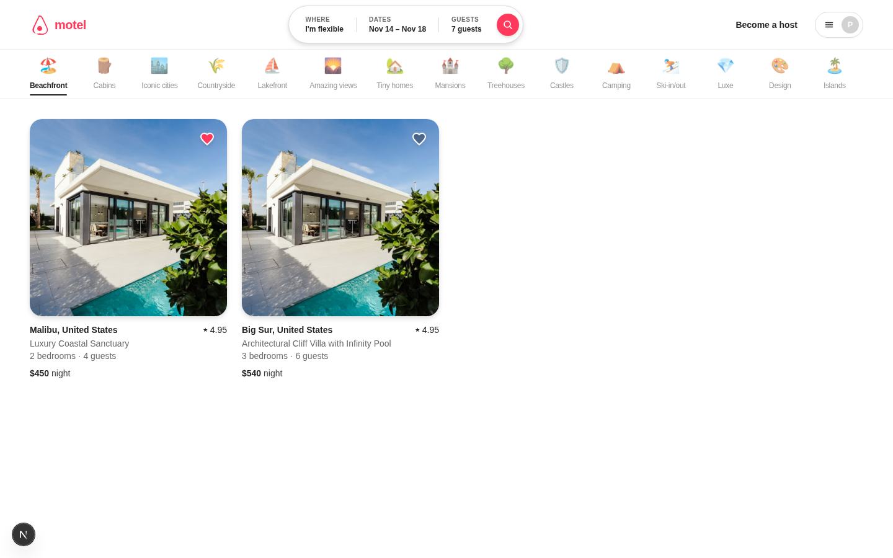
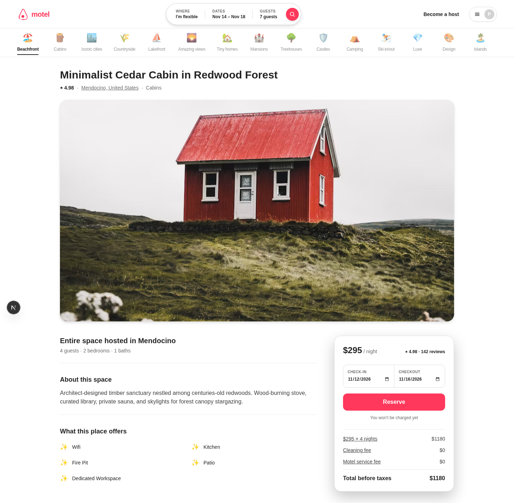
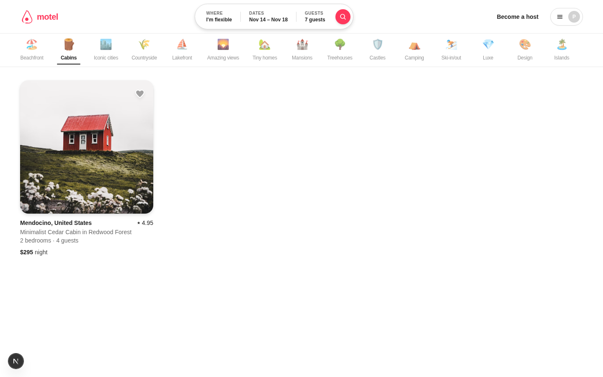
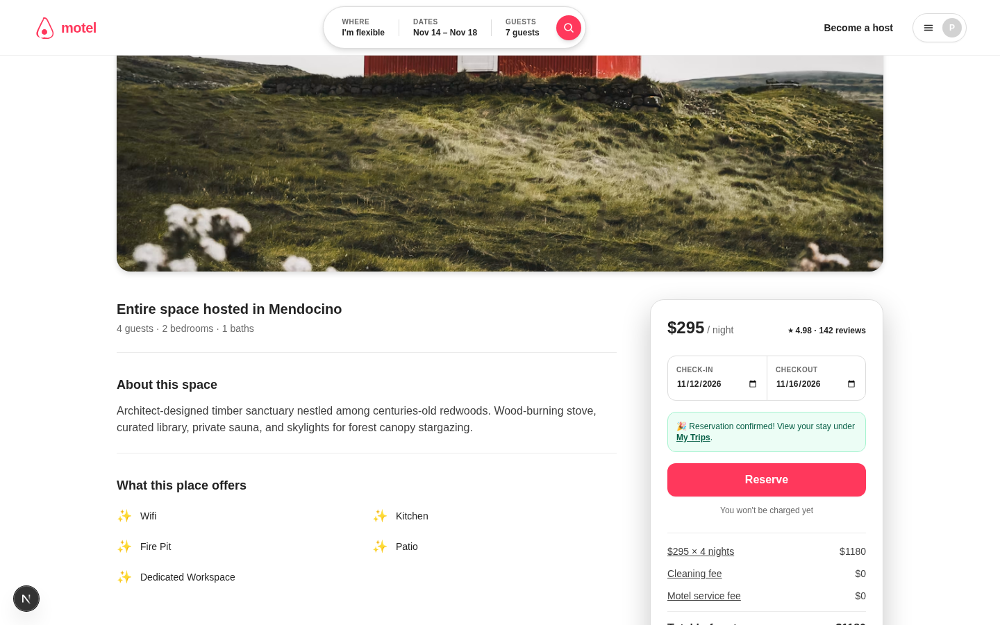
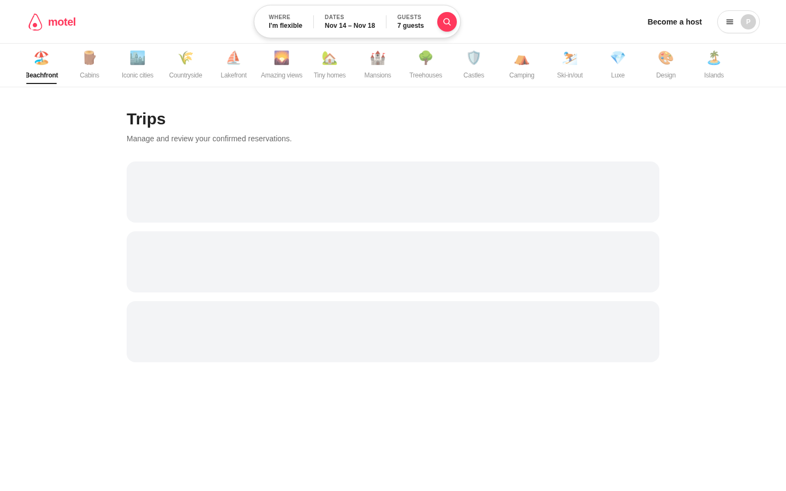
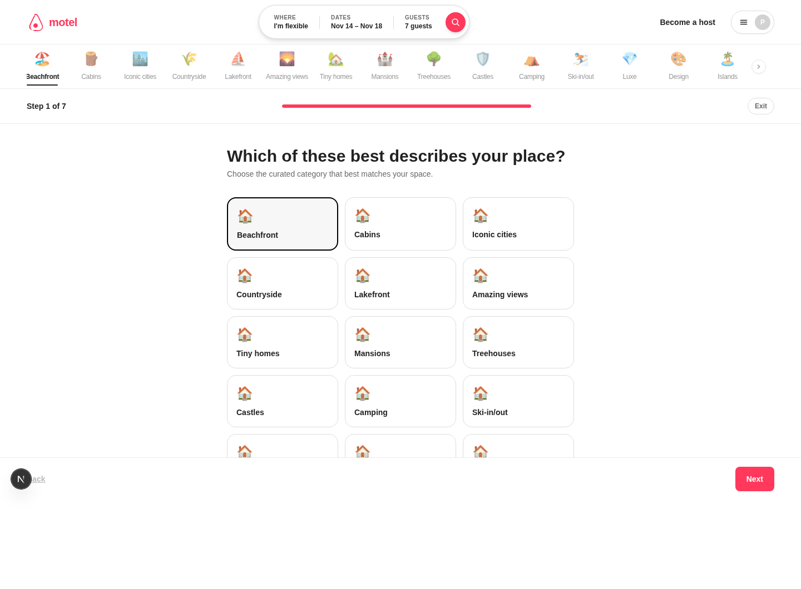

<div align="center">

# 🏝️ motel

**A peer-to-peer property-rental marketplace** — hosts publish listings, guests discover, filter, favorite, and book stays with database-enforced double-booking prevention.

<p>
  
  
  
  
  
  
</p>

<p>
  <a href="#-demo">Demo</a> ·
  <a href="#-features">Features</a> ·
  <a href="#%EF%B8%8F-architecture">Architecture</a> ·
  <a href="#-quick-start">Quick start</a> ·
  <a href="#-api">API</a> ·
  <a href="#-testing">Testing</a> ·
  <a href="#-documentation">Docs</a>
</p>

</div>

---

## 🎬 Demo


> The full 60-second walkthrough is available as [`docs/demo/demo.gif`](docs/demo/demo.gif) and [`docs/demo/demo.mp4`](docs/demo/demo.mp4).

<details open>
<summary><b>📸 Screenshots</b></summary>

| Discover | Listing detail |
| :---: | :---: |
|  |  |

| Category filter | Reservation confirmed |
| :---: | :---: |
|  |  |

| Trips | Host wizard |
| :---: | :---: |
|  |  |

</details>

---

## ✨ Features

- **🔎 Discovery** — browse a seeded catalog across **15 curated categories** (Beachfront, Cabins, Iconic cities, Countryside, …) with a category pill bar and an expandable Where / Dates / Guests search bar.
- **🏠 Listing detail** — hero gallery, amenities grid, host info, and a sticky reservation card with live price breakdown (`price × nights`).
- **📅 Reservations** — atomic check-in → check-out booking with **database-level double-booking prevention** via a PostgreSQL GiST exclusion constraint. Overlapping concurrent requests are rejected with `409 CONFLICT`, never silently overwritten.
- **❤️ Favorites** — optimistic wishlist toggling powered by TanStack Query mutations with rollback on error.
- **🧳 Trips** — review confirmed reservations and cancel them.
- **🛠️ Host wizard** — a 7-step animated listing-creation flow with a client-session draft persisted to `localStorage` until atomic creation.
- **🎨 Design system** — shared Tailwind tokens + Radix-style primitives in `@motel/ui`, with Framer Motion micro-interactions.

---

## 🏗️ Architecture

A type-safe **Bun monorepo**. The API is the single source of truth; the frontend consumes it through an end-to-end typed tRPC client — no hand-written REST DTOs.

```
motel/
├── packages/
│   ├── contracts/   # Zod schemas + tRPC types (single source of truth)
│   ├── db/          # PGlite embedded PostgreSQL client + schema + seed
│   └── ui/          # Shared React primitives + Tailwind preset
├── apps/
│   ├── api/         # Elysia HTTP server + tRPC router  (:3001)
│   └── web/         # Next.js 15 App Router frontend   (:3000)
├── scripts/
│   └── record-demo.mjs   # Reproducible demo capture (Playwright)
└── docs/            # ADRs, contracts, demo assets
```

### The stack

| Layer | Choice | Why |
| :--- | :--- | :--- |
| Runtime | **Bun** | Fast workspace tooling, native TS, built-in test runner |
| Frontend | **Next.js 15** (App Router) | Server components, file-based routing, streaming |
| API | **Elysia** + **tRPC 10** | Lightweight fetch-native server; fully typed RPC |
| Validation | **Zod** | Shared input/output schemas across the wire |
| Database | **PostgreSQL** via **PGlite** | Real Postgres semantics embedded in-process |
| Data access | Thin typed client | Parameterized queries, Prisma-like ergonomics |
| Styling | **Tailwind** + **Radix** patterns | Consistent, accessible primitives |
| Testing | **Bun test** | Unit, integration, and e2e smoke suites |

### 🛡️ Concurrency invariant

Double-booking is prevented **in the database, not in application code**:

```sql
ALTER TABLE "Reservation"
ADD CONSTRAINT "reservation_no_overlapping_confirmed"
EXCLUDE USING gist (
  "listingId" WITH =,
  daterange("startDate", "endDate", '[)') WITH &&
)
WHERE (status = 'CONFIRMED');
```

When two guests race for the same dates, Postgres raises `23P01`, which the API maps to a `409 CONFLICT` via `isReservationExclusionViolation()`. The e2e suite asserts that exactly one of two simultaneous requests succeeds.

---

## 🚀 Quick start

**Prerequisites:** [Bun](https://bun.sh) v1.4+.

```bash
# 1. Install dependencies
bun install

# 2. Seed the embedded database (listings + demo users)
bun run db:seed

# 3. Start the API (:3001) and web (:3000) concurrently
bun run dev
```

Then open **http://localhost:3000**.

| Command | Description |
| :--- | :--- |
| `bun run dev` | Start API + web in parallel |
| `bun run dev:api` / `bun run dev:web` | Start one service |
| `bun run db:seed` | Seed the PGlite database |
| `bun run check` | Lint + typecheck + test (CI guardrail) |
| `bun run lint` / `bun run typecheck` | Individual checks |
| `bun run build` | Build all packages + Next.js production build |
| `bun test` | Run the full test suite |

### 🎥 Regenerating the demo assets

The GIF/MP4 in `docs/demo/` are produced by a reproducible Playwright capture — never a fragile screen grab (which is why they can't come out black):

```bash
bun run dev            # in one terminal
bun run db:seed
bun run demo:record    # drives headless Chromium, captures video + screenshots
bun run demo:video     # WebM → MP4
bun run demo:gif       # MP4 → full GIF
bun run demo:highlight # MP4 → compact README hero GIF
```

---

## 🔌 API

The API exposes a single **tRPC** endpoint at `/trpc` (plus a `/health` check). Auth uses a `Bearer <userId>` token (`user_*` / `test_*` in local dev; RS256 Clerk JWTs in production).

```ts
appRouter = {
  listings: {
    search,   // public  — category / destination / guests / price / date filters
    byId,     // public  — single listing
    create,   // protected
    delete,   // protected — guarded against upcoming reservations
  },
  reservations: {
    create,         // protected — GiST-guarded, 409 on conflict
    myReservations, // protected
    cancel,         // protected — guest or host
  },
  favorites: {
    toggle,       // protected
    myFavorites,  // protected
  },
}
```

Example request:

```bash
curl 'http://localhost:3001/trpc/listings.search?batch=1&input=%7B%220%22%3A%7B%22category%22%3A%22Beachfront%22%7D%7D'
```

---

## 🧪 Testing

```bash
bun test          # run everything
bun run check     # lint + typecheck + test (what CI runs)
```

- **Unit** — `packages/contracts` schema validation, `packages/ui` primitives.
- **Integration** — `packages/db` against an isolated in-memory PGlite instance.
- **E2E smoke** — health check, category search, and the **concurrent-reservation** test that fires two simultaneous bookings and asserts one `200` + one `409`.

> Tests run against isolated in-memory PGlite (`dataDir: undefined`) to avoid file-lock contention. Set `DATABASE_DIR` only when you need persistent data.

---

## 📚 Documentation

- [`AGENTS.md`](AGENTS.md) — monorepo navigation & environment commands
- [`GLOSSARY.md`](GLOSSARY.md) — domain language (Listing, Reservation, Host/Guest, …)
- [`CODING_STANDARDS.md`](CODING_STANDARDS.md) — reviewer judgment calls
- [`docs/adr/`](docs/adr/) — architecture decision records
- [`docs/contracts/`](docs/contracts/) — listing & reservation contract specs
- [`docs/demo/`](docs/demo/) — recorded demo assets & capture script

---

## ☁️ CI

`.github/workflows/` runs `lint → typecheck → build → test` on every push and PR to `main`.

---

<div align="center">
<sub>Built with Bun, Next.js, tRPC, and a healthy respect for database constraints.</sub>
</div>
